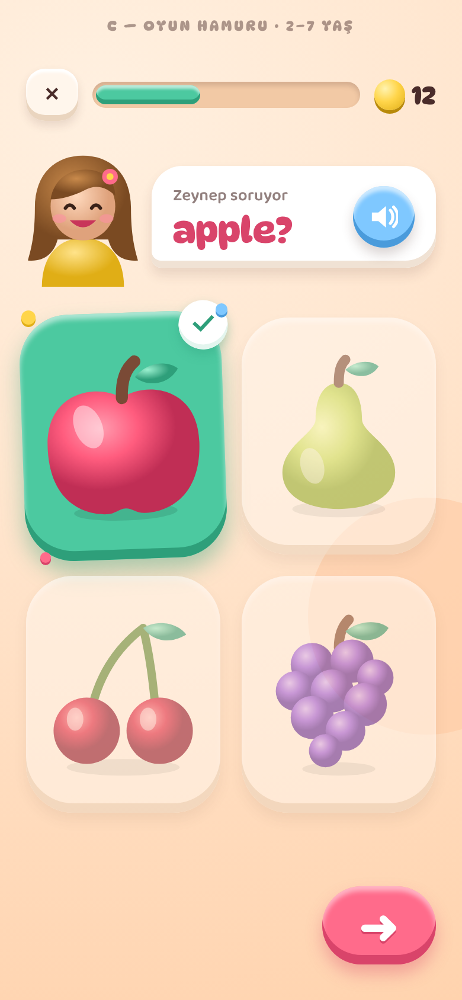
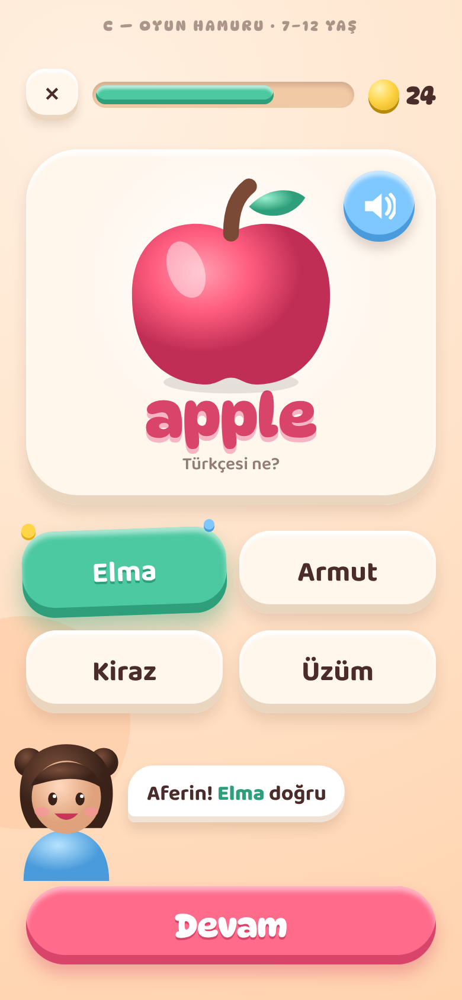
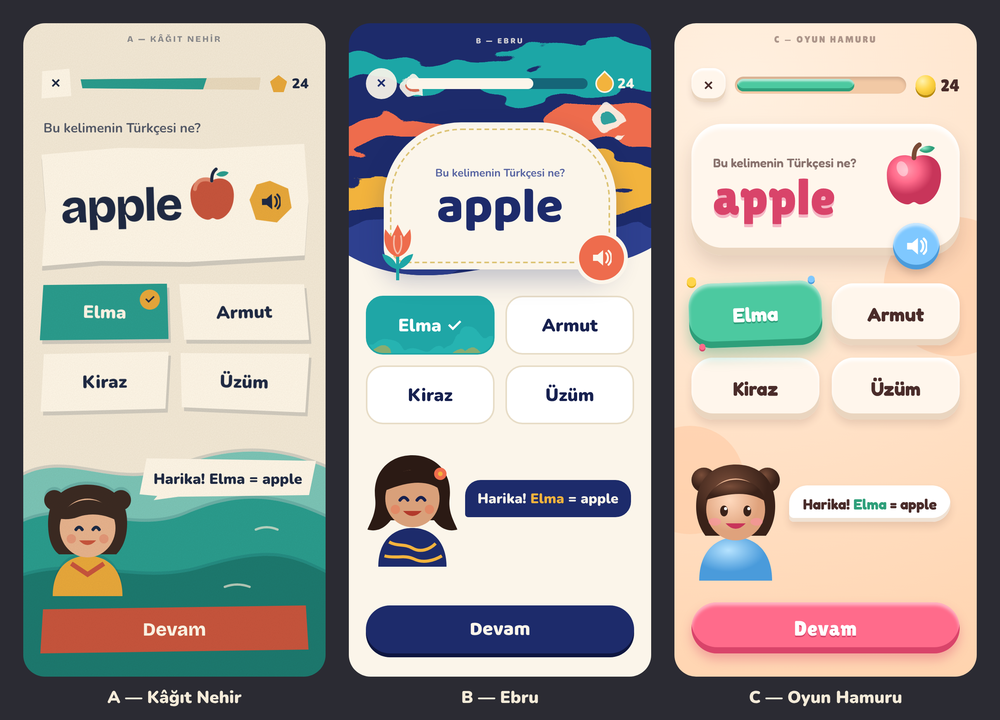

# Sanat yönü

**Durum:**
- Çocuk profilleri (2–7, 7–12): **C — Oyun Hamuru**, görsel öncelikli ✅ (Furkan, LNG-4)
- Yetişkin profili: ayrı, yetişkinlere yönelik tema — seçim bekliyor (LNG-39)

## Onaylı çocuk teması

| 2–7 yaş | 7–12 yaş |
|---|---|
|  |  |

- Görsel öncelik: 2–7'de seçenekler resim kartı, soru Zeynep'in sesinden; 7–12'de soru kartının en büyük öğesi resim.
- Fontlar: **DynaPuff** (başlık) + **Baloo 2** (gövde). İlk örnekteki Lilita One ve Fredoka'da `ğ ş İ` olmadığı için değiştirildi.
- Kaynak HTML/SVG: `art-direction/src/`.

## İlk karşılaştırma (üç yön)

Üç yön de aynı ekranla gösterildi: 7–12 yaş, çoktan seçmeli soru, doğru cevap anı, Nehir karakteri.

| | A — Kâğıt Nehir | B — Ebru | C — Oyun Hamuru |
|---|---|---|---|
| Doku | Kâğıt grain, düzensiz kesik kenarlar | Ebru akışları (Skia shader) | Kil: iç gölge + üst parlama |
| Palet | Krem, nehir turkuazı, zerdeçal, kiremit, mürekkep laciverti | Çivit, turkuaz, mercan, safran, altın | Şeftali zemin, nane, ahududu, limon, gök mavisi |
| Başlık fontu | Bricolage Grotesque | Baloo 2 | Lilita One + Fredoka |
| Ödül birimi | Kâğıt taş | Ebru damlası | Hamur boncuğu |
| Güçlü yanı | El yapımı, sıcak, yetişkine de yakışır | En özgün; Türk kültürü + "nehir" adıyla anlam bağı | En oyuncaklı; 2–7 yaşa en çekici |
| Riski | Animasyonda düzensiz kenarlar ek iş | Ebru shader performansı düşük Android'de test edilmeli | Yetişkin modunda fazla çocuksu kalabilir |

Görseller: `art-direction/a-kagit-nehir.png`, `b-ebru.png`, `c-oyun-hamuru.png` (390×844 @2x).
Karakter çizimleri yalnızca stil örneğidir; Zeynep, Nehir ve Kerem'in son tasarımı LNG-30/31'de yapılır.
