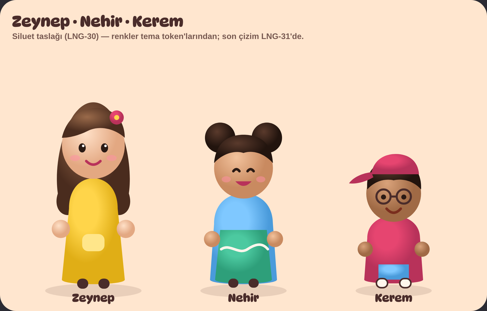

# Karakterler: Zeynep, Nehir, Kerem

2–7 yaş modunun (`mini`) üç çocuk karakteri. Bu belge tek kaynaktır: illüstrasyon, Rive animasyonu ve ses kaydı bununla tutarlı olmalı. Görsel dil: `.claude/skills/art-direction` (Oyun Hamuru).

_Taslak (LNG-30): yalnızca siluet, oran ve renk ayrımını gösterir. Son çizim LNG-31'de._

## Üç karakter bir bakışta

|                       | Zeynep                                               | Nehir                                                    | Kerem                                                                      |
| --------------------- | ---------------------------------------------------- | -------------------------------------------------------- | -------------------------------------------------------------------------- |
| Görünen yaş           | 7 (en büyük)                                         | 5–6                                                      | 4 (en küçük)                                                               |
| Boy (baş birimi)      | 3,2 baş                                              | 2,9 baş                                                  | 2,6 baş                                                                    |
| **Siluet imzası**     | Omuzları geçen dalgalı saç + çiçekli toka            | Başın üstünde **iki yuvarlak topuz**                     | **Ters takılmış kep** (siperlik arkada) + yuvarlak gözlük                  |
| Ana renk (token)      | `reward` limon sarısı                                | `correct` nane yeşili + `info` gök mavisi                | `accent` ahududu                                                           |
| Kıyafet               | Sarı elbise, cepli                                   | Mavi tişört, üstünde dalga desenli yeşil tulum           | Ahududu tişört, mavi şort, beyaz spor ayakkabı                             |
| Ten / saç             | Açık-buğday ten, kahverengi saç                      | Buğday ten, koyu kahve saç                               | Esmer ten, kısa kıvırcık siyah saç                                         |
| Kişilik               | Meraklı, sabırlı, açıklayıcı                         | Neşeli, enerjik, yol gösterici                           | Komik, biraz sakar, asla vazgeçmeyen                                       |
| **Uygulamadaki rolü** | Soruları sorar ve kelimeleri okur ("Zeynep soruyor") | Haritada rehber; doğru cevapta ve seviye atlamada kutlar | Yanlış cevapta cesaret verir ("Hadi bir daha!"); çıkartma albümünün sahibi |
| İmza hareketi         | El çırpar                                            | Kendi etrafında döner                                    | Zıplar, kepini düzeltir                                                    |

**Kural:** Üçü renk olmadan da (gri tonlamada, sadece siluetle) ayırt edilebilmeli: uzun saç / iki topuz / kep.

## Ortak çizim kuralları

- Hamur (kil) görünüm: radyal gradyan, ışık **sol üstten**, altta yumuşak temas gölgesi, tombul ve yuvarlak formlar; keskin köşe yok.
- Baş büyük (gövdeye oranı ~1:1,6), iri ve basit gözler (tek beyaz parıltı), küçük burun (yalnızca gölgeyle), yanaklarda pembe allık.
- Renkler yalnızca tema token'larından (`src/theme/themes.ts`, `kidsTheme`). Çizgi (outline) yok.
- Gerçekçi değil, stilize; karikatürleştirilmiş etnik özellik, dini ya da siyasi sembol, marka logosu yok.
- Üç karakter birlikte görünürken boy sırası her zaman Zeynep > Nehir > Kerem.

## İfade sayfası (her karakter için)

| İfade                  | Ne zaman                                     |
| ---------------------- | -------------------------------------------- |
| Nötr / gülümseyen      | Bekleme (idle)                               |
| Konuşma (A, O, M ağız) | Soru okurken, yönerge verirken               |
| Mutlu                  | Doğru cevap                                  |
| Çok mutlu / kutlama    | Seri (3/5/10), tur sonu, seviye atlama       |
| Düşünen                | Soru beklerken uzun süre dokunulmazsa        |
| Cesaret veren          | Yanlış cevap (asla üzgün ya da kızgın değil) |
| Şaşkın                 | Yeni dünya / yeni kelime açılınca            |
| Uykulu, el sallayan    | Oturum sonu ("yarın görüşürüz")              |

Yanlış cevapta **hiçbir karakter üzgün, hayal kırıklığına uğramış ya da kızgın görünmez** (kids-ux: ceza yok).

## Rive durum makinesi (her karakter ayrı `.riv`)

- Durumlar: `idle` (nefes, göz kırpma) · `talk` · `happy` · `celebrate` · `encourage` · `think` · `wave`.
- Girdiler: `talking` (bool), `mouth` (0 = kapalı, 1 = A, 2 = O, 3 = M), tetikleyiciler `happy`, `celebrate`, `encourage`, `wave`.
- Tetikleyiciden sonra kendiliğinden `idle`'a döner; `celebrate` ≤ 2,5 sn.
- Dosya yolu: `assets/characters/{zeynep,nehir,kerem}.riv`. Artboard boyutu 512 × 640, karakter ayakları alt kenara 32 px.

## Görsel üretim istemleri (illüstratör veya görsel yapay zekâ)

Her istemi **ortak stil + karakter + ifade** olarak birleştir. Tutarlılık için aynı tohumu (seed) ve referans görseli kullan.

**Ortak stil (İngilizce, değiştirmeden):**

> chubby clay figurine character, soft matte plasticine texture, warm light from the top left, soft contact shadow, plain peach background #FFE6CF, big head with 1:1.6 head-to-body ratio, simple round dark eyes with one white highlight, tiny nose only by shading, pink cheeks, no outlines, no text, full body, front three-quarter view, children's educational app style

**Karakterler:**

- **Zeynep:** a cheerful 7-year-old Turkish girl, light tan skin, long wavy brown hair past the shoulders with a raspberry flower hair clip on the right, lemon yellow dress with a light yellow pocket, dark brown shoes
- **Nehir:** a lively 5-year-old Turkish girl, warm tan skin, dark brown hair in two round high buns on top of the head, sky blue t-shirt, mint green overalls with a white wavy river stripe, dark shoes
- **Kerem:** a playful 4-year-old Turkish boy, medium-brown skin, short curly black hair, raspberry baseball cap worn backwards, round dark-rimmed glasses, raspberry t-shirt, sky blue shorts, white sneakers

**İfadeler:** `happy smile` · `laughing, eyes closed, arms up` (kutlama) · `talking, mouth open in an O` · `thinking, finger on chin` · `encouraging, thumbs up, kind smile` · `waving goodbye, sleepy eyes`

**Olumsuz istem:** realistic, photo, scary, angry, sad, crying, outlines, text, logo, extra fingers, religious symbols, flags

## Ses (LNG-32 ile birlikte)

Her karakterin sesi o yaşa uygun, sıcak ve net olmalı; Zeynep ve Nehir kız, Kerem erkek çocuk sesi. Kelimeler hem İngilizce hem Türkçe kaydedilir. Kayıt mümkün değilse TTS yedeği (`expo-speech`) kullanılır ve karakterler konuşma animasyonunu yine oynatır.
